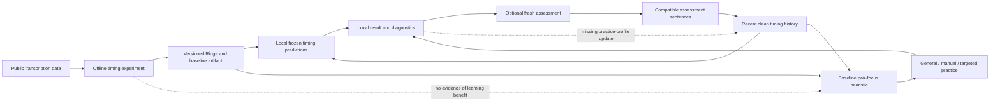

# TypeForge review: what to improve and why

Status: review and consensus planning complete, 15 November 2026. All independent evidence and actual Claude's comparative challenge are integrated. Sequential Architect and Critic approved revision 3; no additional quality gates are configured. [Final receipt](typeforge-planning-receipt.json) binds the exact reviewed bytes. Planning only; application source remains unchanged from `de69444`.

## Recommendation

Build a coherent, polished daily-practice experience first, with UI and interaction quality as a primary deliverable. Repair demonstrated correctness and responsiveness problems alongside it. Then make practice inform an explicit, separately versioned coaching policy. Keep Ridge experimental until it improves a useful decision against a simpler alternative.

This is more substantial than changing colours and less speculative than building another model. Actual Claude's comparison supports redesigning practice, the in-place result, returning Home and the practice summary. Preserve TypeForge's calm identity and local-first character; compare two visual/interaction prototypes before choosing their final form.

## What TypeForge currently does well

- It is a working timed typing app with native editing, retained-error accuracy, rolling passages and General/Manual/Recommended practice.
- It stores results locally, handles several save failures, exports/deletes readable results, and protects legacy/assessment comparisons.
- Ridge genuinely runs in the browser. Its offline experiment has participant/text/history boundaries, fitted-model parity and explicit limitations.
- It honestly separates a baseline-selected focus from experimental timing predictions. Neither the reviewed code nor the experiment proves typing improvement.

The main gap is a product loop: starting and repeating are awkward, practice state is hard to see, and practice never updates the profile used for suggestions. UI hierarchy compounds that gap. A model can run correctly while being irrelevant to the user's next action.

## Constituent problems → fixes → expected improvement

| Part | Problem | Recommended change | Why it helps / how to judge it |
| --- | --- | --- | --- |
| Ready and repeat | Focus and settings are lost; practice completion points toward an unavailable assessment | Intentional-entry focus, validated remembered choices, clear focus recovery, practice-first Again with correct lineage handling | Less setup and a continuous repeat journey. Verify actions/keystrokes and controls; enjoyment/return still need user evidence. |
| Visual and interaction quality | Competing hierarchy, low active line, hidden warnings and confusing error rendering | Claude-owned practice-stage versus refined-layout prototypes; designed ready/running/error/result/failure states; stable visible feedback; consistent type/spacing/colour roles | A clearer, more comfortable experience is the adoption hypothesis. Verify state screenshots and native geometry, then human preference/comprehension; do not infer preference from screenshots. |
| Reliable editing and feedback | Undo nulls diagnostics; some integrity consequences are hard to notice | Visible truthful notices now; a separate explicit Undo/Redo accounting and compatibility contract before changing scoring | Users understand what their actions did. Preserve native edits and historical scores; never synthesize timing evidence. |
| Daily continuity | Practice is stored but has no useful activity summary | Practice count/session-time and one supported takeaway, separate from assessment trend; optional daily sequence after the foundation works | Users can see what they did and what comes next. Exact totals are testable; motivation and sustained use remain hypotheses. |
| Responsive coaching | Assessment-only profile ignores practice; clean-timing gates miss error evidence | A bounded derived practice profile with distinct error/timing evidence, freshness/context boundaries and deletion rules | Practice can change the next suggestion. This proves responsiveness, not that the suggestion improves skill. |
| Honest targeting | Common-pair cadence can lower dose; numerical noise can produce a focus; Ridge packaging can disable the heuristic | Verify actual exposure/context diversity, abstain on no effect, separate coaching config/policy from prediction artifact, retain useful General fallback | Suggested activities match their labels and remain resilient. Validate synthetic counterexamples and delivered dose before studying effectiveness. |
| Engineering foundation | Three Windows tests fail; input work grows under CPU constraint; history work is unbounded | Repair LF/CRLF harness, profile duplicate paint/layout work, paginate visible history and bound optional summary/profile processing | Safer changes and a consistent experience over repeated use. Use reproducible checks and same-environment before/after measurements. |
| ML evidence and privacy | Timing MAE is not decision quality; aggregate means cannot measure local loss; local responses are not anonymous | Keep current benchmark frozen; later compare policies and matched shadow prediction losses using minimal, consented evidence only when needed | ML gains a defensible role if it wins a useful comparison. No new telemetry, training or study is needed for immediate UX fixes. |

## What the two competitors teach

Actual Claude exercised Monkeytype and Keybr in fresh browser contexts. [The three-way matrix](typeforge-claude-benefit-review.md) records observed flows and untested paths; [the clarification](typeforge-claude-clarifications.md) corrects initial design proposals and receipt hashes.

- **Monkeytype:** a reference for immediate typing, quiet run state and easy restart. Its observed first key focused the input but was absorbed; guest/mobile/AT coverage was limited.
- **Keybr:** a reference for an understandable practice path and visible state that changes after lessons. Four scripted lessons showed in-place continuation and a letter unlock, not human learning. The observed mobile clipping and Tab behavior are not features to copy.
- **TypeForge:** a plausible reason to choose it is calm, local practice with honest feedback and native editing. That positioning needs a stronger experience to be credible. This is a design/product hypothesis, not demonstrated competitive superiority.

## Current data and learning loop

The planned bridge is a **separate practice profile and policy**, not feeding practice into frozen assessment calibration or promoting Ridge because its timing MAE is lower. Its exact observation/support/effect/freshness/provenance contract is a named prerequisite task, not an executor guess.

## Sequence and stop gates

1. **Fix proven small defects and prepare the design comparison.** Green LF/CRLF checks, truthful no-origin/Undo/integrity states, no-effect targeting regression. Claude prototypes the two coherent experience directions; no new framework/backend.
2. **Deliver the complete practice foundation.** Remembered settings, safe focus, visible passage and feedback, in-place results/repeat, practice activity. Preserve native geometry and assessment semantics; profile the affected hot path and prevent optional history from delaying basic typing.
3. **Connect practice to suggestions.** First settle and version the smallest policy/profile contract; then implement derived updates, bounded reads, deletion/context reset, meaningful abstention and dose checks. General stays useful and available.
4. **Evaluate stronger claims separately.** Usability, coverage, policy quality, retention and held-out transfer each need different evidence. No automatic model promotion, account system, cloud collection or trial recruitment.

The detailed roadmap and verification requirements are in [the PRD](prd-typeforge-review-breakdown.md) and [test specification](test-spec-typeforge-review-breakdown.md); [the ranked register](typeforge-reconciled-findings.md) retains evidence, confidence, impacts and corrections. Their authored draft headers are preserved to keep the approved bytes unchanged; the final receipt records their subsequent approval. Carry forward Critic's nonblocking caution: optional predictions cannot attach after any edit, even if the engine still reports idle.

## Verification limits

Fresh full client checks: **94/97 tests passed**, with three line-ending-sensitive harness failures. Separate typecheck/build passed. Committed production browser regression: **39/39 passed**. ML-specific client tests: **21/21 passed**; learning subset: **43 passed**; these overlap and must not be added together. Python: **19/21 passed**, with two missing-sklearn errors in an environment different from the pinned reproduction environment.

No real screen reader, OS IME, physical-device, Firefox/Safari or actual browser-zoom certification. No human enjoyment, retention or learning result. Live JS/CSS matched local built bytes at observation time; deployment Git SHA and whole-site parity are not proved.

## Decisions genuinely needing Owen

- At the later visual prototype checkpoint, choose between the two evidenced experience directions using concrete artifacts and usability observations. No preference decision is needed before those prototypes exist.
- If expanding beyond keyboard-familiar physical-keyboard copy practice, choose whether beginner curriculum or mobile-keyboard support is actually a near-term goal. Current planning keeps the narrower audience and responsive viewing as an explicit assumption.
- Human study size/recruitment and the smallest worthwhile learning effect are later research decisions, not blockers to ordinary UI/UX improvement.

Meaningful review/planning artifacts are tracked in Git. Future implementation uses small behavior-focused commits, targeted regressions, independent review and explicit version/compatibility decisions. No application edits, deployment, private-data collection or implementation handoff is authorized by this review.
