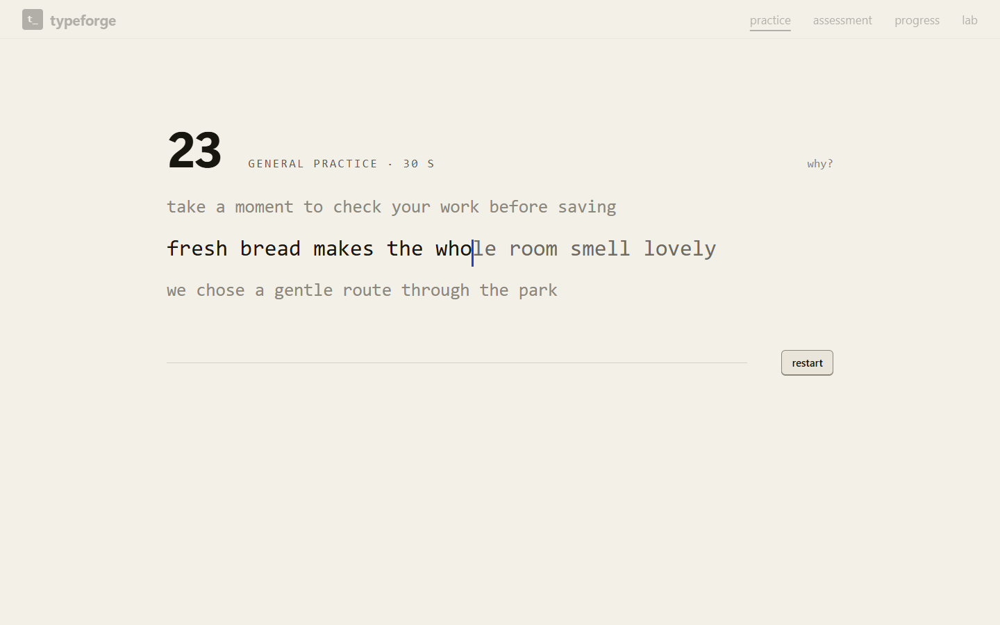
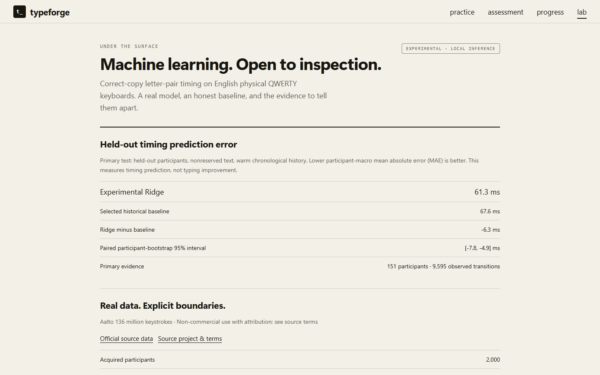
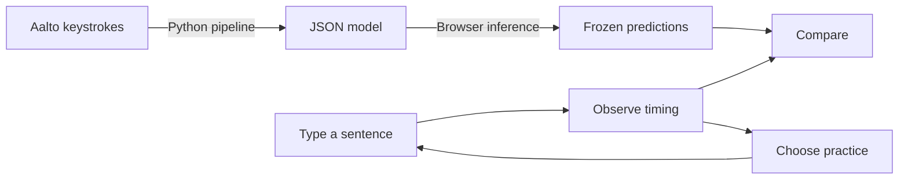

# TypeForge

TypeForge opens straight into typing practice and can suggest letter pairs after ten qualifying 30-second QWERTY assessments. Timing predictions run locally, and your typing history stays in this browser. **[Try the live demo](https://typeforge-alpha.vercel.app)**

 

### How it works

**Public-data timing prediction · 30 September 2026.** Mean absolute error per typist was **61.30 ms for Ridge** vs **67.55 ms for the baseline** (151 held-out typists, 9,595 intervals). Typing gains remain unmeasured.

### Next

- Estimate expected letter-pair timing for a typist at your speed.
- Choose practice for pairs where you consistently take longer than expected.
- Test whether targeted practice helps on fresh text.

**Quick start** · With Node.js 24+ in `typing-app/client`, run `npm ci` and then `npm run dev`. 
[Product details](docs/product.md) · [ML experiment and reproduction](ml/README.md) · [Verification](docs/verification.md)
