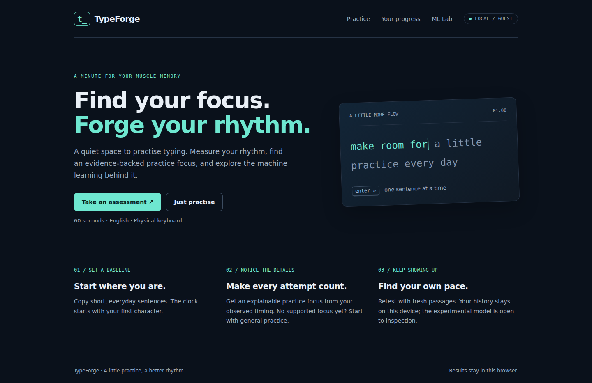

# TypeForge

A local-first typing platform and inspectable applied-ML portfolio project. Take a 60-second assessment, follow an evidence-supported practice focus, and retest on fresh passages. The ML Lab separates experimental prediction evidence from unproven coaching benefit. The broader competitor-quality platform remains a roadmap, not a claim of feature parity.

## Product preview

<a href="docs/screenshots/home-desktop.png"></a>

Actual local Chromium captures, 30 September 2026: [Home](docs/screenshots/home-desktop.png) · [Practice](docs/screenshots/practice-desktop.png) · [ML Lab](docs/screenshots/ml-lab-desktop.png). These show the working app, not mockups or sample user progress.

## Run locally

Use Node.js 24 or newer.

```sh
cd typing-app/client
npm ci
npm run dev
```

Open the local URL printed by Vite. If its default port is occupied, use `npm run dev -- --port 5180`.

```sh
npm run check    # Node tests, TypeScript checking, production build
npm run preview  # serve the production build locally
```

The build goes to `typing-app/client/dist`. Its relative links/assets support deployment beneath `/TypeForge/`. Serve it over HTTP; opening the source HTML directly as a file does not compile TypeScript. The former prototype URLs redirect to the working pages, including `DetailedResults.html?id=...`.

## What works

- Copy one sentence at a time. The first character starts the clock; Enter submits a nonempty response. Normal cursor movement, Backspace, word deletion and selection replacement work.
- Corrected mistakes remain in attempt accuracy. WPM counts retained positional matches, including the final partial response. No-input accuracy is unavailable; all-wrong accuracy is zero.
- Completed runs save in IndexedDB and can be reopened, exported or deleted. Storage failure keeps the current result visible with export and retry controls.
- Interrupted and unsupported-input runs remain labelled in history but do not contribute to headline trends. Leaving or restarting an unfinished run discards it.
- A self-declared physical QWERTY keyboard enables observed letter-pair timing from complete, correct, unedited sentences. Predictions freeze before each sentence. Results compare saved historical-baseline and experimental-candidate predictions with the same later eligible observations; missing or legacy predictions are labelled, never reconstructed.
- Original content includes 80 practice and 40 assessment sentences. A fresh retest excludes every originating assessment passage, including its final partial prompt. Targeted and general practice preserve that origin across save/reopen; a deleted or incompatible origin produces an explained new assessment instead. General-practice scores stay separate from assessment trends.

Results belong to this browser profile and origin. Changing the hostname or port creates a different local store. Clearing site data removes local history; export JSON to keep a copy. Accounts and cloud sync are still planned. The app can finish and save a loaded session without a network connection; offline reload is not supported.

## ML evidence and coaching

The default coach is the validation-selected historical baseline, not the experimental candidate. A focus needs at least eight observations, support in three practice-bank sentences and a positive score; otherwise the next action is honestly labelled general practice. Focused drills alternate two target-bearing sentences with one general sentence.

The browser uses a versioned JSON artifact with local linear inference. [ML documentation](ml/README.md) covers source/license, exact acquisition and reproduction commands, participant/text holdouts, chronological history, baselines, uncertainty and limitations. The ML Lab reads the paired generated report; missing or mismatched evidence is explicitly unavailable. Real-data acquisition/training is separate from CI. Public-data accuracy does not prove TypeForge transfer or typing improvement.

```text
Public data → bounded Python acquisition / audit / holdouts → trained JSON artifact
                                                             ↓
Native typing → frozen browser predictions → later observations → local IndexedDB
                                                             ↓
                                    explained baseline focus → fresh retest
```

### Bundled experiment (30 September 2026)

The genuine Aalto acquisition contains **2,000 participants**; conservative eligibility retains **1,386 participants, 5,812 trials and 117,653 transitions**. Model `aalto-ridge-83f562c419d5` links to report `benchmark-92947653a001` in `typing-app/client/src/generated/`.

The preregistered primary held-out/warm/nonreserved-text slice has **151 participants and 9,595 transitions**. Participant-macro MAE is **61.30 ms** for Ridge versus **67.55 ms** for the frozen smoothed-pair baseline (k=1). The paired participant-bootstrap 95% interval for Ridge minus baseline is **−7.76 to −4.89 ms**. These are public-data timing prediction errors, not typing gains or proof of transfer to TypeForge. The historical baseline remains the coach; the candidate stays experimental. Inspect the report for secondary slices, exclusions and uncertainty limitations.

## Code map

| File | Responsibility |
| --- | --- |
| `typing-app/client/src/engine.ts` | Pure clock-driven state, positional scoring, sentence eligibility and timing aggregates |
| `typing-app/client/src/app.ts` | Native input events, page views, charts and navigation |
| `typing-app/client/src/corpus.ts` | Versioned original sentence banks and selection |
| `typing-app/client/src/model.ts`, `profile.ts` | Strict artifact inference, rolling history, baseline coaching and retest lineage |
| `ml/` | Offline acquisition, benchmark, trained export and synthetic parity fixtures |
| `typing-app/client/src/storage.ts` | Bounded result validation and direct IndexedDB transactions |
| `typing-app/client/tests` | Node's built-in tests; no test framework |

Vite and TypeScript are development dependencies. The browser bundle uses native DOM, CSS, SVG and IndexedDB APIs. There are no remote fonts, runtime CDN scripts, frontend framework or inference service.

## Verification

The current local checks pass: **49 client tests**, TypeScript checking and production build, plus **21 offline Python tests**. Bundled parity fixtures check all **682 features**, fitted Python estimator versus exported browser predictions (relative tolerance **1e-6**), baseline predictions and synthetic event/history advancement. CI runs the frontend checks and offline Python tests; acquisition and training stay outside CI.

Current scoped Chromium 155 acceptance covers native edits and real-clock successive Enter submission; assessment/save/reload; baseline-focused and general practice lineage; fresh-retest exclusions; IndexedDB v1→v2 preservation/pagination; quota-failure export/retry; missing/malformed-model and missing/mismatched-report fallbacks; extreme stored-prediction rejection; and the actual ML Lab metrics. Restart reloads bounded calibration and rechecks deleted retest origins; undeclared QWERTY skips calibration reads. Loaded-session offline typing and no prediction/upload API traffic were checked. Layout checks at 1440px and 390px found no page-level horizontal overflow. A static `/TypeForge/` smoke check also passed.

See the [verification record](docs/verification.md) for reproducible checks, dataset/artifact hashes, browser coverage and explicit gaps. CSS 200% zoom, label/focus, timer and reduced-motion checks are scoped evidence, **not** a complete accessibility audit. Firefox, Safari, screen readers and physical-device timing remain untested release gates.

## Release boundaries and next milestones

Local implementation covers native typing, visible evidence/fallbacks, baseline practice and saved lineage; the genuine model/report are bundled and Python/browser fixture parity is checked. Current scoped browser acceptance and independent re-review pass: code review **APPROVE**, architecture **CLEAR**, with no unresolved findings in the repaired local slice. Initial findings remain recorded. This is not public-release approval. See [PLAN.md](PLAN.md) for the staged roadmap and [DESIGN.md](DESIGN.md) for the interface contract.

Accounts/cloud sync, an independently consented TypeForge transfer pilot, Firefox/Safari/physical-device QA and public launch remain unfinished. No external accounts or services have been provisioned. Public deployment and a hiring outcome are not implied by a successful local build. Follow the [product research](docs/research/typing-products.md) when considering interaction changes.

Schema-v1 optional prediction/focus/lineage extensions preserve old records in the new app. IndexedDB upgrades non-destructively to database version 2 to add the compound completedAt/id history index, without rewriting existing records. An old app opening database version 1 cannot open this upgraded database, and its validator may also reject extended records. Export before downgrading; schemaVersion and metricVersion remain 1. Corrupt records are skipped visibly, not used as evidence or silently cleared.
