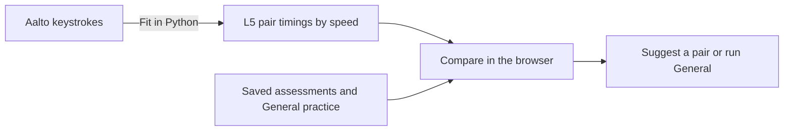

# TypeForge

TypeForge opens straight into typing practice. Suggested names a letter pair your saved typing shows is slower than expected at your speed. It runs General practice if the evidence is thin, the model fits your recent typing poorly, or you haven’t declared a physical QWERTY keyboard. Your history and predictions stay in this browser. **[Try the live demo](https://typeforge-alpha.vercel.app)**

 

### How it works

**Ridge · 30 September 2026.** For 9,595 individual intervals from 151 held-out typists, mean absolute error per typist was **61.30 ms** for Ridge and **67.55 ms** for the historical baseline.

**L5 coach · later pair timing.** Of 16,659 held-out typists, 4,240 had repeated pairs to score. Mean absolute error was **0.204 log ms** for L5 against **0.288** for the typist’s own earlier average. The paired 95% interval for the reduction was **0.079–0.088 log ms**. Whether practising these pairs helps on fresh text remains open for the planned trial. [Fresh test results](ml/coach/REPORT.md#fresh-test)

**Quick start** · With Node.js 24+ in `typing-app/client`, run `npm ci` and then `npm run dev`. 
[Product details](docs/product.md) · [Models and reproduction](ml/README.md) · [Verification](docs/verification.md)
