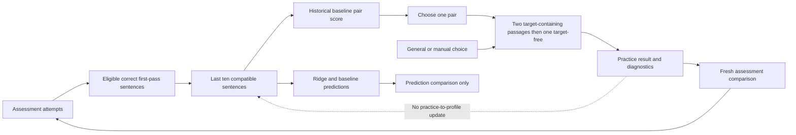

# TypeForge learning and product utility review — 15 November 2026

TypeForge has a credible, unusually candid measurement foundation and a usable *mechanism for offering practice*, but it has not established a mechanism that reliably diagnoses a learner's needs, responds to their practice, or improves typing beyond ordinary practice. The priority is to close that learning loop with modest, testable coaching. Targeted digram practice is a reasonable experimental option, not an evidence-established default or a reason to put Ridge predictions into control of the product.

This is an independent learning review. No other lane's report was read. Interface presentation, interaction quality and visual judgments belong to Claude; the proposals below specify learning behavior and evidence requirements for Claude and the coordinator to consider.

## Scope, provenance and validation

- Local source: `de69444a6201da96281ca9ad88088904477775a2`, branch `feature/daily-practice`, Windows PowerShell, Node `v24.21.0`. This is not a deployed-site inspection.
- Read the common contract, handoff, learning specification and installed `C:/Users/Owenc/.codex/prompts/researcher.md`. Its primary-source and uncertainty standards apply; the explicit worker assignment also authorizes the repository inspection, despite the generic prompt normally routing that elsewhere. No subagents, servers, browser contexts, builds, application changes or dependency changes.
- Requested launch: Codex, `gpt-6-astra`, `high`, recorded in `.omx/reviews/typeforge-20261115/learning-launch.json`. That receipt initially reported startup unknown. During this review, the execution-shell ancestor was `codex.exe` PID 20756, argv `-m gpt-6-astra` and `model_reasoning_effort=high`; see [runtime receipt](learning-evidence/runtime-receipt.json). This establishes the actual running Codex client's model/effort configuration, not an independently observable server-side model identity or provider endpoint. Backend serving identity is unverified; no numeric telemetry was used to infer effort.
- Fresh narrow verification: 43 engine/profile/corpus/model tests passed, zero failed; [test output](learning-evidence/source-tests.txt). They verify source contracts, not learning, browser usability, real recommendation coverage or deployment parity.
- Added a standalone, read-only [source probe](learning-evidence/source-probe.mjs) and [captured results](learning-evidence/source-probe.json). It imports production pure functions, uses synthetic events and seeded corpus sampling, and never touches browser history or human data. Run from the repository root with `node docs/reviews/2026-11-15/learning-evidence/source-probe.mjs`.
- Bounded literature retrieval on 2026-11-15: four typing-specific primary studies plus a small broader-feedback check. Source links, access depth and limits appear below and in [research provenance](learning-evidence/research-provenance.md). No competitor efficacy claims were used. Historical memory search produced no task-specific product evidence; current source and handoff govern.

All source references below are at the pinned commit. Short filenames such as `profile.ts` and `generated/model.json` are relative to `typing-app/client/src/`; fully written paths are repository-relative. **Source** means inspected implementation; **probe** means synthetic execution; **inference** means a consequence not measured in users; **hypothesis** means a proposed learning benefit requiring an experiment. Severity ranks product usefulness, not security or visual quality.

## What practice actually does

| Stage | Current mechanism and evidence | Learning implication |
|---|---|---|
| Enter | A normal Practice link supplies `mode=practice`; absent parameters mean general practice, 60 seconds, keyboard undeclared. `typing-app/client/src/app.ts:28-50`, `89-90`, `151-180`. | Typing is available immediately. Ordinary navigation does not itself restore a calibrated practice context. This is a source finding for Claude to verify in the journey. |
| Collect | Timed lowercase English copying; positional retained-character WPM, all-insertion attempt accuracy, deleted-character count, per-expected-key first-attempt errors. `engine.ts:205-215`, `298-319`. | Corrections cost time and do not erase mistakes from accuracy. The key tally says which expected positions went wrong, not necessarily which physical key is defective. |
| Filter | Only completed, correct, unedited, supported sentences retain within-word lowercase pair intervals; intervals above 5 seconds are omitted. `engine.ts:323-381`; `model.ts:60-68`. | This is a clean-copy timing sample, not a complete picture of error, hesitation or real typing. Long-gap omission does **not** necessarily make the whole sentence ineligible. |
| Calibrate | Last ten eligible submitted sentences from compatible **assessments**, with duration, mode version, language, corpus and QWERTY declaration matching. `profile.ts:18-47`. Assessment history also updates after eligible submissions within the active run: `app.ts:383`. | Practice never updates this history. Earlier eligible sentences from a later-interrupted assessment can still count: sentence eligibility and headline run eligibility differ. |
| Select focus | At least eight observations of a pair and three supporting practice passages; score is `max(0, baselineLogMs(pair) - meanUserLogMs) × pairOccurrencesInPracticeBank`. `profile.ts:52-74`. Bundled baseline is smoothed-pair with k=1: `generated/model.json:3-6`; calculation in `model.ts:91-98`. | It chooses a frequently available pair slower than this person's overall eligible timing. This is neither a population-normalized deficit nor an estimate of how trainable it is. |
| Predict | Ridge predicts interval values from pair identity, word context and prior timing; predictions freeze before the sentence. `model.ts:71-126`; `engine.ts:185-198`; `app.ts:205-210`. | Ridge runs locally and is compared with observations, but does not select practice. A prediction improvement alone would not establish a useful intervention. |
| Practise | General bank shuffles 80 sentences. Manual or recommended focus builds 120 entries in a repeating two-target-containing/one-target-free pattern. Target banks can repeat. `corpus.ts:6-87`, `148-156`; `profile.ts:89-105`. | There is pair enrichment for some pairs, but no adaptive difficulty, dose normalization, mastery check or in-run change of target. |
| Reflect/return | Results show accuracy, errors, pair means, predictions and a next action; practice results encourage assessment, with a separate keep-practising action. Headline trend uses compatible assessments only. `app.ts:546-581`, `640-682`. | Good auditability, but little evidence-based answer to “what changed through today's practice, and what should I do tomorrow?” |

## Strongest existing qualities

1. **Truthful boundaries already exist.** Results say predictions do not select the focus, label the focus a hypothesis, and warn that a fresh-passage change does not prove a practice effect (`app.ts:551`, `564`, `581`). Preserve these distinctions while simplifying presentation with Claude.
2. **Mistakes are not erased by correcting them.** The probe's `cxt → cat` example ends with the correct response, 75% attempt accuracy, one deletion, one first-attempt `a` error, and no timing pairs. That is more informative than reporting 100% accuracy after correction (`engine.ts:298-319`, `361-381`).
3. **Meaningful fallbacks.** General practice works without a model; manual focus is explicitly user-chosen, not diagnosed (`app.ts:34-50`, `210`). Unsupported evidence is not fabricated.
4. **Practice and assessment are separated.** Distinct banks, compatible-setting comparisons, origin tracking and exclusion of the originating assessment's passages reduce obvious same-text comparison problems (`corpus.ts:6-129`; `profile.ts:108-120`). This is a useful foundation, though not a complete experimental holdout system.
5. **Local, inspectable records.** The app saves to browser IndexedDB and offers export/deletion (`storage.ts:218-239`, `267-282`, `339-341`; `app.ts:585-590`, `698`). The bounded supplied corpus avoids needing someone's private writing to start practice.

## Independently ranked utility gaps

### L1 — High: practice cannot teach the recommender anything

**Source + probe; high confidence.** `profile.ts:28-35` selects assessments only, and `app.ts:383` appends only assessment sentences. The probe selects zero summaries when an otherwise identical run is practice, one when assessment. Repeated practice alone cannot unlock recommendations, alter the estimated weakness or retire a mastered target. With no new assessments, “Keep practising” can keep the same historical focus indefinitely. The ten-sentence history also has no age expiry, so recent means “last observed eligible,” not necessarily recent in calendar time.

**Impact:** a daily-practice user gets a sequence of exercises rather than a responsive coach. Beginners who want practice before being tested face the sharpest mismatch. A proficient user's improvements are not recognized until another compatible assessment.

**Recommendation:** add a separately versioned practice profile with provenance and freshness, while preserving frozen assessment and offline benchmark rules. Include error evidence and clean timing as separate signals. Do not merely feed all practice into the existing benchmark-calibration function.

**Acceptance:** an eligible practice block can update a subsequent practice suggestion; corrected-error evidence remains usable for error coaching; stale/insufficient evidence yields an explained general fallback; historical assessment results and frozen predictions remain byte-for-byte unchanged. A practice update must never be described as a measured learning gain.

### L2 — High: “two focused, one general” can reduce the target dose

**Source + deterministic corpus calculation; high confidence.** `profile.ts:91-103` makes the general subset explicitly target-free. Current `th` appears in 71/80 practice passages; `he` in 74/80. Therefore an ordinary uniform passage sample contains those targets more often than the drill's 2/3 schedule.

| Pair | General expected occurrences/passage | Drill expected occurrences/passage | General occurrences/100 characters | Drill occurrences/100 characters |
|---|---:|---:|---:|---:|
| th | 1.350 | 1.014 | 3.151 | 2.373 |
| he | 1.400 | 1.009 | 3.268 | 2.408 |
| ag | 0.0375 | 0.667 | 0.0875 | 1.576 |

These are analytic averages over uniform shuffled banks and complete three-passage cycles, not observed time-based doses. A short timed run can finish before its general passage. Nonetheless the intended enrichment fails for two very common pairs. Those pairs also receive large corpus-occurrence multipliers in the selection score. See `source-probe.json:cadenceExposure` and `profile.ts:68`.

**Impact:** the recommended intervention can be weaker in target exposure than its own general-practice comparator; sparse pairs such as `ag` repeatedly draw from only three sentences. Neither passage count nor faster performance on repeated sentences establishes skill gain.

**Recommendation:** define dose as target opportunities per character or active minute, with diverse word contexts and bounded repeated passage exposure. General practice need not deliberately prohibit the focus pair. Choose the simplest sampler that delivers the declared dose; do not assume 2:1 is pedagogically optimal.

**Acceptance:** for every supported pair, calculate and record expected exposure relative to general practice; a targeted policy must actually enrich its target under the agreed definition or disclose that it does not. Record realized dose, unique words/passages and time in the experiment. Unit tests for cadence alone are insufficient.

### L3 — High: timing eligibility selects away much of the learning problem

**Source + probe; high confidence about mechanism, unknown real prevalence.** A single incorrect or edited character removes *all* timing pairs in that sentence, even correctly typed regions (`engine.ts:299-310`, `361-381`). Final partial sentences also disappear from timing. A 5.1-second pause drops that pair but can leave the sentence eligible; word-start and space transitions never become modelled pairs (`engine.ts:323-355`; `model.ts:60-68`). First-attempt error counts survive when diagnostics are available, but never influence `selectPracticeFocus`.

**Impact:** the model preferentially sees successful, completed, fluent-enough copying. Short runs and slower/error-prone users may produce little usable timing. Lack of evidence can be mistaken for lack of weakness. Long hesitation may mean recall, reading, interruption or fatigue; the current aggregate cannot diagnose which.

**Recommendation:** retain the conservative gate for its explicitly defined prediction task. Build a different practice observation contract: denominator counts, corrected/uncorrected error indicators, meaningful pause categories, and a declared inability to infer finger technique or attention from these events. Start error coaching with existing expected-key counts and exposure denominators; don't claim a substitution confusion matrix, recovery latency or cause of hesitation without collecting the required information.

**Acceptance:** report opportunities, included observations and exclusion reasons by user/run, including unsupported input. A synthetic corrected mistake should contribute to error coaching while remaining excluded from the existing clean-copy benchmark. A general fallback must be a useful next activity, not a demand to produce perfect assessment sentences.

### L4 — High: the score is a convenience heuristic, not a diagnosis or expected benefit

**Source; high confidence.** The score compares pair timing with the same user's global timing and multiplies by occurrences in the **authored practice corpus**, not their real writing (`profile.ts:56-74`). A naturally slower movement, unfamiliar word or reading delay can rank highly without being unusually weak or improvable. The log difference is not milliseconds of recoverable time. Eight observations is a count gate, not a confidence interval; they can come from few contexts. The last ten sentences can cause an unstable winner without a real ability change.

There is also baseline-policy coupling: no artifact returns the user mean, so every focus score is zero (`model.ts:91-98`). A user-mean baseline would do likewise; a population baseline can rank eligible pairs largely by corpus occurrence rather than personal pair differences. The current bundled smoothed-pair baseline avoids those particular degeneracies, but a future predictive-model selection can change recommendation behavior without a learning rationale.

**Recommendation:** separate the coaching policy contract from the best prediction baseline. Compare a general policy, an error-rate policy with minimum opportunity counts, and a stable clean-timing policy. An ML challenger must improve decisions or downstream outcomes against those, not simply improve interval prediction MAE.

**Acceptance:** focus explanations state evidence quantity, observation context and uncertainty; no “weakness” or expected gain from the score alone. Recommendation stability and context diversity are logged. Changing a predictive artifact cannot silently change the coaching algorithm. Predefined fallback works when evidence is absent or conflicting.

### L5 — Medium-high: availability is unknown and likely uneven

**Source + synthetic opportunity analysis; high confidence in gates, no real-user coverage estimate.** QWERTY must be declared; history is split by duration; recommendation needs eight observations and three supporting passages (`app.ts:45-68`; `profile.ts:18-31`, `59-66`). Corpus inspection finds 184 supported manual pairs, not all 676 possible lowercase pairs.

For 1,000 seeded draws of distinct assessment sentences, assuming *perfect completed first passes*, any pair passes the count-and-bank gates in 0/1,000 one-sentence windows, 8/1,000 three-sentence windows, 633/1,000 five-sentence windows and 1,000/1,000 ten-sentence windows. This ignores positive timing score, errors, time, interruptions and declaration: it is an opportunity illustration, **not recommendation yield**, nor a universal bound across users who repeat passages. At ten sentences only 2.965 pairs qualify on average in this simulation. Broad personal diagnosis cannot be inferred from a recommendation appearing.

**Recommendation/acceptance:** measure real coverage from all consenting starts: time and sessions to first supported focus, eligible sentence fraction, represented pairs and contexts, reasons for general fallback, and effects of duration/device/skill. Decide thresholds after this evidence. Do not lower gates merely to make the product appear personalized. Remembering compatible practice preferences is a Claude/coordinator dependency, not a visual verdict from this lane.

### L6 — Medium-high: challenge and transfer are narrower than ordinary typing

**Source; high confidence.** All 80 practice and 40 assessment prompts contain only lowercase letters and spaces; the engine rejects other prompt content (`engine.ts:146-150`; `corpus.ts:6-129`). There is no curriculum for locating keys, capitalization, punctuation, numbers, coding, multilingual text or composing original prose. Changing duration changes the bucket and endurance demand, not skill-specific difficulty. The fixed banks have no learner-dependent lexical progression.

**Impact:** the product is currently plausible for already keyboard-familiar English copy typists seeking short practice. It is not yet a beginner touch-typing course or a general productivity trainer. A proficient typist's ordinary bottleneck may be editing, punctuation, composition or unfamiliar vocabulary, all outside the timed-pair objective.

**Recommendation:** state that initial audience explicitly; offer an easy general accuracy/rhythm goal without inferring fingering. Test richer task packs only after their measurement contract is defined. Keep a versioned lowercase assessment for continuity, and use separately labelled transfer tasks. Do not silently change the existing corpus and pool the scores.

**Acceptance:** scope is visible in claims; new content has separate versions/metrics; held-out evaluation includes new words and, if ordinary typing is claimed, punctuation/case and an editing or composition task. Performance on copy text alone cannot establish writing productivity.

### L7 — Medium: feedback describes the session but does not close a daily learning cycle

**Source + inference; high confidence in outputs, unknown motivational effects.** Key errors are ranked by raw count (though denominators are displayed), pair times by slowest geometric mean; neither is linked to a coached error intervention (`app.ts:641-661`). The result offers retest/keep-practising and the progress page summarizes assessment WPM (`app.ts:568-581`, `675-682`). No observed mastery or practice target history is synthesized across days. History is valuable; it is not yet an explanation of progress.

**Recommendation:** one explicitly chosen goal, one short activity, one honest reflection, one return cue. Show what was practised and how much; distinguish session performance, accumulated evidence and retained improvement. Use accuracy with pace, not WPM alone, and label errors as observations rather than failures of effort. A nonpunitive return option and optional stopping point are product hypotheses; no streaks or notifications are necessary to test them.

**Acceptance:** after a session, users can state what they practised, why it was suggested, and what their result does and does not show. Returning users can continue a meaningful goal without needing to reinterpret a prediction report. Claude owns the presentation and usability evaluation.

### L8 — Medium: claims can sound stronger than the underlying learning evidence

**Source + interpretation; medium confidence about reader interpretation.** Home copy says “evidence-backed practice focus” and “Make every attempt count” (`app.ts:107`, `118`); the result later says hypothesis, not diagnosis (`app.ts:564`). Observational support for a slow pair is real; evidence that this *prescription improves typing* is absent. “Every attempt” is also broader than recommendation eligibility.

**Recommendation/acceptance:** make “suggested from your recent clean-copy timing; benefit not yet established” the semantic contract wherever personalization is advertised. Preserve stronger claims only after the relevant retention/transfer experiment. Have Claude test comprehension rather than imposing final copy from this lane.

## Bounded research: what changes the recommendation

| Evidence | What it supports | Boundary and product consequence |
|---|---|---|
| **Direct typing experiment:** Baddeley & Longman (1978), [publisher abstract](https://www.tandfonline.com/doi/abs/10.1080/00140137808931764), postal workers learning alphanumeric keyboard entry under different schedules. | Distributed training was more efficient than the most intensive schedule studied. | Hour-long training of that task does not establish an optimum five-minute modern-app dose. Offer manageable repeated visits; test adherence and retention. Don't advertise a scientifically optimal daily duration. |
| **Direct typing, observational:** Keith & Ericsson (2007), [primary-study abstract](https://pubmed.ncbi.nlm.nih.gov/17924799/), 60 experienced student typists. | Typing experience and reported performance-directed practice/class history related to proficiency. | Interview associations do not randomize instruction or show that this digram policy works. Purposeful goals are plausible; generic activity time and self-selection remain alternative explanations. |
| **Direct typing, observational plus task manipulations:** Pinet et al. (2022), [full article](https://pmc.ncbi.nlm.nih.gov/articles/PMC9356123/), 1,301 university students. | In this sample reported deliberate practice did not distinguish higher/lower proficiency groups, while other typing habits did. | Different population, predominantly French/AZERTY context; no causal verdict that deliberate practice is useless. This challenges a strong necessity claim and makes ordinary practice an essential active comparator. |
| **Direct typing experiment in altered-key learning:** Yamaguchi & Logan (2014), [institutional author manuscript](https://research.edgehill.ac.uk/ws/files/20172048/YamaguchiLogan_2014a.pdf), DOI [10.1037/xlm0000026](https://doi.org/10.1037/xlm0000026), abstract and Experiment 4/general discussion. | Transfer in acquiring a changed letter-key association depended on word, letter and surrounding digraph structure. | Learning a relocated key is different from improving an intact familiar keyboard. It makes pair/context effects plausible but does not validate slow-pair ranking. Test new words containing the target separately from repeated words and unrelated text. |
| **Broader motor-learning extrapolation:** Winstein & Schmidt (1990), [primary-study abstract record](https://openurl.ebsco.com/contentitem/doi%3A10.1037%2F0278-7393.16.4.677?id=ebsco%3Adoi%3A10.1037%2F0278-7393.16.4.677&sid=ebsco%3Aplink%3Acrawler); Wishart & Lee (1997), [publisher abstract](https://journals.sagepub.com/doi/10.2466/pms.1997.84.3.1107). | Practice feedback and delayed retention can dissociate; feedback-frequency effects are task-dependent, including a null fading effect in the latter study. | No justification to remove ordinary typing error feedback. Hold coaching/feedback constant across experimental policies, and test retention without extra coaching cues. A between-block reflection is a hypothesis, not a universal feedback prescription. |

**Decision:** targeted digram timing drills are justified as a bounded next hypothesis because the app already exposes controllable pair practice and sequence context can matter in typing. They are not justified as the sole daily-practice mechanism: current diagnosis ignores errors, common-pair scheduling can reduce dose, and prediction evidence does not identify trainability. The simpler first product hypothesis is that a clear goal plus varied general/error-focused practice and useful reflection improves return value. Test the incremental benefit of timing targeting on top of that shared experience.

## Proposed daily-practice mechanism for Claude/coordinator consideration

**Scope:** keyboard-familiar adults using physical QWERTY and English, initially lowercase copy practice. No beginner-course claim, health/finger diagnosis, paid training, notifications, accounts or cloud collection required. Start with a small local vertical slice, not a new ML system.

1. **Orient with a short general warm-up.** First visit: choose an accuracy/rhythm goal and collect ordinary practice evidence; returning visit: reuse an eligible, recent practice context. Always allow general practice. A suggested total session of roughly 3–5 minutes is a feasibility hypothesis, not a research-derived optimum or obligation.
2. **Choose one interpretable activity.** Offer varied general practice by default. If repeated first-attempt errors have enough opportunities and contexts, offer sentences containing the implicated key/word contexts with an accuracy goal. If clean pair timing is sufficiently supported, offer timing focus as an explicit experimental alternative. Let the learner override or skip without implying noncompliance.
3. **Practise in short blocks with real exposure accounting.** Keep natural words/sentences, sufficient context variety, an ordinary pace/accuracy instruction and a stop option. General/error/timing policies share the same block duration and feedback. Record delivered target opportunities and repeated contexts; retire or broaden a focus based on multiple fresh observations, not one lucky fast block.
4. **Reflect on performance, not claimed learning.** Report activity, effort/time, attempt accuracy and selected evidence, with uncertainty or insufficient data. “Fewer errors in this block” is a session observation; “you learned this pair” requires retention. No need to make prediction diagnostics the learning objective.
5. **Return and occasionally check.** Save the goal/evidence locally, permit an unpenalized return, and suggest an optional fresh assessment on a predetermined schedule. A separate practice profile updates future suggestions. Immutable assessment evidence and protected experimental probe texts remain isolated.

| Dependency / owner handoff | Acceptance before calling the slice complete |
|---|---|
| Engineering + ML: versioned practice observations, distinct from frozen assessment/prediction history | Error and timing eligibility are explicit; past scores/predictions are not rewritten; deletion/reset has a defined effect on derived practice profiles. No raw private text required. |
| Learning/product: general, error and timing policy definitions | Each has a reason, eligible population, fallback, dose and stop rule. Error policy uses rates plus sufficient opportunities; timing policy cannot imply recoverable WPM. |
| Corpus/engineering: sampler and context coverage | Targeted exposure exceeds its declared comparator where promised; report unique contexts, exposure and repeats. Freeze study texts separately. |
| Claude: entry, goal choice, feedback and return journey | Participants understand the activity and limitations and can complete/continue it; visual and interaction acceptance comes from Claude's own evidence. |
| Coordinator: study protocol and privacy | Voluntary opt-in, data dictionary, local review/export and withdrawal rules exist before collecting pilot data; no retrospective upload of existing histories. |

**Alternatives:** (A) polished varied general practice with the same goal/reflection—lowest complexity and the required active control; (B) error-focused coaching from existing counts—closer to a direct cost of mistakes but still an untested policy; (C) clean-timing focus—already partly implemented but needs dose repair; (D) ML-selected intervention—defer until it can outperform B/C on a decision metric and retained outcomes. These are competing hypotheses, not a mandatory sequence of ever-more-complex models.

## Feasible evaluation: five claims, five kinds of evidence

Do not collapse useful interface, recommendation availability, training performance and transferable learning into one “works” result.

| Claim | Feasible check | What it cannot establish |
|---|---|---|
| **Usability / perceived utility** | Claude-led first/returning-session walkthroughs with 6–8 people spanning lower/higher proficiency; completion, time to meaningful practice, interpretation of feedback, reasons to return. Ask for spontaneous explanations before prompting. | No effect on typing skill or population-wide retention estimate. |
| **Recommendation coverage** | In an opt-in feasibility sample of roughly 12–20 users, log all starts, finishes, missing/invalid observations, opportunity denominators, time to focus, target stability and fallback reason over about a week. Inspect skill/duration/device strata descriptively. | Perfect-data simulation or only successfully recommended users cannot establish real coverage; small strata cannot support reliable disparity claims. |
| **Proximal improvement** | Standardized pre/post probes of the trained pair in practiced and new words. Report clean timing **alongside** opportunity coverage, all-attempt accuracy, retained text accuracy and time/correction cost. | Faster repeated text is not retention or general transfer; cleaner-only timing can improve merely because hard attempts were excluded. |
| **Retention** | Repeat matched probes 48–72 hours and about seven days after the final training block, before additional app practice or coaching that day. Record intervening ordinary typing and other practice. | A transient post-session benefit is not a retained benefit; outside practice remains an uncertainty. |
| **Held-out transfer** | Fresh protected passages with new words containing the target, fresh general passages and separately labelled case/punctuation/editing or composition tasks where the claim warrants them. Matched duration/settings; common scoring; no coaching during probes. | New sentences reusing trained words establish less than new-word transfer; copy WPM does not prove faster or better composition/work output. |

### Fair comparison of policies

After feasibility and instrumentation checks, use a small randomized **parallel-group** pilot rather than a simple before/after success story or a crossover that cannot wash out learning. A feasible illustrative pilot is about 30–45 participants, 10–15 per arm, for 7–10 days with equal assigned active typing time. This is a feasibility/variance pilot, **not a powered efficacy claim**. Final size, duration and smallest worthwhile effect require a precision/power calculation informed by pilot participant-level variance and Owen's recruitment capacity.

- Arm A: varied general practice. Arm B: error-focused practice. Arm C: timing-pair-focused practice. All receive the same goal language, feedback, time, rest opportunity and assessment schedule. Freeze policies before randomization; don't tune C on its test outcomes.
- Stratify randomization by baseline proficiency/accuracy and supported device context. Obtain more than one fresh baseline sample when practical to reduce a one-run fluctuation determining the comparison. Do not select the worst pair on the same observations used as the sole pretest outcome: this creates regression-to-the-mean pressure.
- For **product-policy effectiveness**, randomize all in-scope consenters and retain fallback users in their allocated arm. Report intention-to-treat results and coverage. For the narrower **target-mechanism** question, separately preregister analysis among people whose baseline evidence supports the relevant target before assignment. Do not quietly exclude C's cold-start failures after randomization.
- Keep assignment time equal; record realized typing time, repetitions and target opportunities rather than forcing an artificial exposure match that erases the intervention. Report whether any benefit is only increased target dose; a later dose-matched mechanistic study could distinguish targeting quality from extra repetitions.
- Choose a participant-level primary outcome in advance, for example retained performance on unseen comparable copy text at the seven-day check, with a prespecified accuracy guardrail. Define the text-alignment/error scoring first; current positional-match WPM may penalize insertion shifts differently from conventional transcription metrics. Analyze participant means or a justified hierarchical model, never treat thousands of transitions as independent randomized participants. Report effect estimates and uncertainty; use secondary outcomes to explain, not replace, an unfavorable primary result.
- Examine baseline-adjusted arm differences; publish accuracy, dropout, missing outcomes and exclusion denominators. Complete-case improvement among diligent returners is not an unbiased treatment effect. Sensitivity analyses should show whether plausible missing outcomes or eligibility changes reverse the conclusion. A small pilot can expose unacceptable friction, coverage collapse, signal direction and measurement variance; it cannot establish superiority, subgroup efficacy, an optimal cadence or long-term transfer.

### Measurement selection bias and benchmark separation

Maintain two ledgers: **practice adaptation** and **evaluation**. The adaptive profile may learn from eligible practice observations; protected experimental assessment/probe text and outcomes never enter target selection or policy tuning. Freeze recommendations before each block, preserve model/policy/corpus versions and hashes, and store original predictions. Existing assessment origin exclusion only removes that origin's prompt IDs (`profile.ts:116-120`); it does not guarantee all follow-up passages are novel across every prior session, unseen words or a globally reserved experimental test bank.

The current measurement funnel conditions on finishing, correctness, no edit, supported layout, interval bound, matching settings, and enough repeated pairs. Report each stage separately. Analyze clean-interval change as conditional on that funnel; pair it with all-attempt outcomes and retained eligible fractions. A policy that makes difficult attempts disappear from timing must not win by that omission. The 5-second bound should remain in the existing benchmark, while an explicitly separate practice metric can count excluded long gaps without labelling their cause.

Do not retrain on, relabel or change inclusion rules for the existing frozen public-data benchmark to improve pilot results. Do not call a lower Ridge MAE evidence for typing gains. Do not continually reuse a study holdout as a coach-selection development set. New product experiments need their own dated protocol, data version and holdout boundary.

### Consent and privacy

The review itself collected no participant data and uploaded no local records. A future study should request explicit opt-in before exporting anything, describe event/timing fields, use study IDs, define retention/deletion and withdrawal limits, and allow ordinary local use without enrollment. Export aggregate counts, exposure and summary timings where sufficient; avoid names, private writing and raw key streams by default. If a composition task is needed, use a provided nonsensitive scenario and let the participant inspect what will be shared. Local guest history is not a secure multiuser identity, and a manual keyboard declaration is not device verification. Keep diagnostics needed for measurement proportionate to the actual question.

## True decisions for Owen after synthesis

1. **Initial audience:** accept keyboard-familiar English/QWERTY copy typists as the first supported learning audience, or fund a separate beginner/content curriculum? Current evidence supports the narrower initial scope.
2. **Product promise:** should the first release promise enjoyable, explainable practice with experimental suggestions, or require a retained-transfer result before marketing improvement? The present evidence supports the former wording only.
3. **Experiment capacity:** how many voluntary participants and follow-up days can be supported, and what magnitude of retained improvement would justify keeping a targeted policy over general practice? This determines study scope; it is not a reason to guess a benefit threshold.

No decision is needed on visual styling from this lane. No implementation or study enrollment has been started. The next authorized coordinator step is to reconcile these independent findings with Claude, ML and engineering, particularly practice-profile isolation, actual recommendation availability and the common-pair dose reversal.
