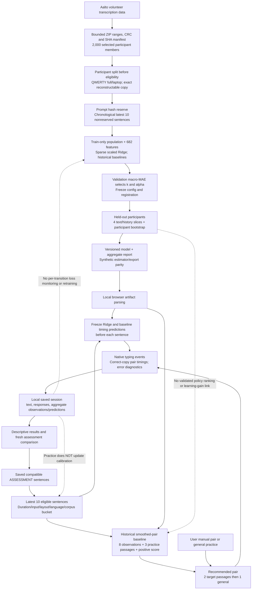

# TypeForge ML, data and evaluation review — 15 November 2026

**Verdict:** a credible, bounded timing-prediction experiment and a useful local instrumentation foundation; not yet a validated adaptive-practice system. Keep Ridge experimental. Improve the practice feedback loop and test an explicit, simple targeting policy before considering model-driven practice. The immediate opportunity is not another model fit.

## Scope, independence and evidence

Read-only review of `ml/`, current client model/profile/engine/application/storage/corpus code, tests, frozen experiment, fitted-estimator fixtures, generated model/report, and historical verification. No application edits, dependency changes, dataset acquisition, real-data training, frontend build or browser server. No design/visual/UX verdicts; those belong to Claude. No other lane's review was read.

Brief base: `de69444a6201da96281ca9ad88088904477775a2`. Checkout at inspection began: `ca1a04a96ee304aa4a71ea171d341102fa3e355f`; later: `b9a2fb97599198506c6123c7aa8f1736149bccf0`. The intervening commits were review/planning documents. `git diff de69444 -- ml typing-app/client/src .github/workflows/check.yml` was empty. Findings therefore concern the brief's application source, not other reviewers' documentation.

Provider evidence: Orca dispatched **Codex / `gpt-6-astra` / high**; the live `codex.exe` PID 19100 argv independently contained `-m gpt-6-astra model_reasoning_effort=high`. This proves launch configuration and the Codex surface, not an independent backend-serving attestation. See [runtime receipt](ml-evidence/runtime-receipt.json). Installed `code-reviewer` and `researcher` prompts informed the bounded review; no subagents were used.

Evidence labels below: **S** = current source; **A** = shipped artifact; **T** = freshly executed test/synthetic probe; **H** = historical documentation; **P** = primary external source; **I** = inference. High confidence means the stated mechanism is verified, not that a proposed improvement has proven benefit.

Source locator convention: bare client filenames below are under `typing-app/client/src/`; `pipeline.py` is `ml/pipeline.py`. JSON pointers refer to `typing-app/client/src/generated/benchmark.json` unless explicitly identified otherwise. Line numbers are from the reviewed source, unchanged from the brief base.

## Current full loop

The dotted arrows identify missing feedback/evidence links, not implemented features. Assessment input also enters the native typing/recording stage directly. There is no inference service and no automatic training/upload loop.

### Exactly what the model and baseline control

| Decision/output | Current mechanism and evidence |
| --- | --- |
| Candidate timing | Ridge dot product with 682 features; all predictions frozen before the sentence. `model.ts:100`, `app.ts:205`, `engine.ts:339`. |
| Candidate comparison | Matching eligible observations accumulate actual/baseline/candidate log sums; results show geometric mean intervals. They are not transition MAE. `engine.ts:341`, `app.ts:593`. |
| Recommended focus | **No Ridge coefficient is consulted.** For each pair with at least 8 observations and 3 distinct supporting practice passages: `max(0, baselineLogMs - userMeanLogMs) * totalBankOccurrences`; highest score wins. `profile.ts:52`. |
| Shipped baseline | Validation-selected smoothed pair, k=1, version `aalto-smoothed-pair-k1-v1`; `(pairLogSum + userMeanLogMs)/(pairCount+1)`. The configuration is frozen; the user's rolling sufficient statistics are not. `model.ts:91`, model JSON `/baseline`. |
| Passage policy | Recommended and manual targets use shuffled target passages twice then a shuffled non-target passage, repeated to 120 entries. General practice shuffles the whole bank. No difficulty learner, contextual bandit or policy training. `profile.ts:89`. |
| Missing/invalid model | Whole artifact rejected. Warm history yields a user-mean baseline; cold history yields no prediction. Since user baseline minus user mean is exactly zero, **Recommended becomes unavailable**. Ordinary typing and manual/general practice continue. `app.ts:9`, `model.ts:91`, `profile.ts:68`. |
| Candidate numerical failure with valid artifact | Only candidate prediction is dropped; historical baseline and targeting can remain. Different from missing/invalid artifact. `model.ts:123`. |
| Missing/mismatched benchmark report | Lab withholds metrics; inference/targeting still use a valid model artifact. Report matching is a display gate, not a targeting gate. `app.ts:708`. |

Synthetic ablation confirmed identical `th` focus and score after replacing all Ridge coefficients/intercept; removing the artifact removed the recommendation. See [probe JSON `/artifactAblation`](ml-evidence/probe.json).

### Which activity updates which evidence

- **Assessment:** eligible submitted sentences update the in-run history before preparing the next sentence (`app.ts:383`). Saved compatible assessment sentences feed future sessions (`profile.ts:28`). A later interruption excludes the run from headline progress but does not discard earlier eligible sentences; eligibility is sentence-specific.
- **General, manual and recommended practice:** save their own results, key diagnostics and eligible pair summaries, but do not update prediction history either within the run or in later calibration. All three draw the same assessment-only profile. Focus is selected at session preparation/restart, not adapted after practice sentences.
- **Progress:** eligible assessments only; newest compatible bucket governs the trend (`app.ts:675`). A practice record may have `eligibleForProgress=true` as a quality property, but the application explicitly filters by assessment mode.
- **QWERTY:** self-declaration defaults to false without an explicit URL value or saved origin. Undeclared runs skip calibration reads, predictions and eligible timing, although ordinary WPM/accuracy can still be recorded. General navigation does not remember the declaration or duration; direct result/retest links carry them. `app.ts:23`, `:28`, `:56`, `:90`, `:108`, `:162`.
- **Buckets:** duration 15/30/60/120 seconds, flow-v1 versus absent legacy Enter mode, QWERTY declaration, language, corpus, schema and metric version must match. Changing duration starts a different calibration bucket. Historical Enter results do not calibrate current flow. `profile.ts:18`.
- **Retention:** latest ten eligible submitted sentences, with no age decay. This is not ten sessions, ten words or ten observations. Warm offline evaluation means *any* earlier eligible nonreserved sentence, not a complete ten-sentence profile.

## Factual strengths

1. Acquisition is unusually explicit for a portfolio project: deterministic member selection, ZIP64 discovery, byte/expansion caps, HTTP range/ETag checks, CRC validation and manifest hashes (`pipeline.py:50`, `:125`). No silent smaller-cohort substitution at export.
2. The implemented split avoids obvious participant and future-label leakage: participant assignment precedes eligibility; reserved prompts never enter fit/tuning/history; chronological nonreserved history is participant-specific; train-only population/scaling are used (`pipeline.py:156`, `:244`, `:284`, `:331`). Tests exercise the critical boundaries.
3. Comparator selection and reporting are honest: validation selects baseline and alpha, participant-macro errors avoid letting long-record participants dominate the reported MAE, paired bootstrap resamples participants, empty slices remain unavailable, and zero ranking coverage is disclosed.
4. Browser inference is inspectable and lightweight. Folded scaler coefficients retain the intercept correctly; strict artifact validation and synthetic Python/TypeScript parity cover feature ordering, cold/warm fallback and eligible event matching. No remote inference dependency.
5. The application distinguishes manual choice, baseline recommendation and experimental candidate; original prompts/responses and frozen prediction identities survive export. Practice is separated from headline assessment trends, and retests exclude the originating assessment's prompt IDs, including the unfinished prompt (`profile.ts:108`).
6. The source and report explicitly reject an efficacy claim. The positive timing result is not silently used to promote Ridge into coaching.

## Scientific audit of the existing experiment

### Provenance, eligibility and population

The [Aalto project page](https://userinterfaces.aalto.fi/136Mkeystrokes/) confirms voluntary consented online transcription and permits research/non-commercial data use with attribution; it points to an archive readme for further terms. The recording-code license is not the data license. No archive was downloaded during this review, so the packaged readme was not independently re-read. Preserve attribution and establish appropriate rights before any commercial reuse; this review does not determine derivative-model licensing.

The [original CHI paper, pp. 3–4](https://userinterfaces.aalto.fi/136Mkeystrokes/resources/chi-18-analysis.pdf) describes self-selected typing-site users, predominantly younger US participants, completing 15 English sentences with Enter and possible breaks. It studies transcription, not a randomized training intervention. Its source sentence material and task differ from TypeForge's lowercase original corpus and timed Space flow. Those differences prevent treating public-data success as local transfer or learning evidence.

Current audit: 2,000 acquired; 1,386 with eligible trials; 5,812 eligible trials / 117,653 intervals including reserved prompts. The processed trial reasons total 28,515: only **20.4%** retained. This is not a 20.4% rate across all acquired people: 79 unsupported-keyboard/layout, 18 invalid-UTF8 and 2 malformed-TSV participants were excluded separately. `/audit/exclusionUnits` correctly distinguishes units.

Filtering requires QWERTY full/laptop metadata, exact final copy, reconstructable one-character events with Shift ignored, strictly increasing printable timestamps, and lowercase within-word pairs with 0 < interval <= 5,000 ms (`pipeline.py:224`). Errors, edits and many controls remove whole trials. Public input lacks browser composition/focus/repeat flags, so matching synthetic event fixtures cannot prove measurement equivalence.

Selection is unequal: processed-trial retention is 7.3% at 0–20 WPM versus 32.5% at 80–100 WPM; 9.7% for metadata error rate >=2% versus 22.5% below 2%. These are derived from artifact counts, not estimates for TypeForge users. Speed/error bands use full-session metadata for audit/stratification only, not predictor features. Layout/keyboard restrictions and missing demographic subgroup checks limit representativeness further. See [artifact audit `/eligibleRates`](ml-evidence/artifact-audit.json).

### Splits, chronological history and leakage

- Acquired groups are exactly 1,400/300/300 train/validation/test; after eligibility the nonreserved groups are 936/193/198 participants. Identity separation is by source participant ID; repeated-human identities under different IDs cannot be checked from shipped aggregates.
- Prompt reservation uses lowercase whitespace-normalized hash modulo five, an approximately 20% partition, not an exact prompt-count guarantee. It does not exclude shared words, bigrams or near-duplicate paraphrases. That is acceptable for held-out *prompt strings*, but not evidence of unseen-language generalization.
- The primary includes 86.72% transition-weighted actual training-prompt overlap. This is disclosed and compatible with a new-participant/familiar-text estimand; reserved slices have zero exact prompt overlap. Do not rename the primary an unseen-text benchmark.
- Earlier test-participant nonreserved sentences calibrate later test predictions. That is a legitimate online warm-history estimand, not cross-split training. Every sentence's observations enter history only after its predictions. Reserved trials never calibrate later trials.
- `audit()` sorts trials by first PRESS_TIME and events by timestamp/keystroke ID. `matrix()` trusts the ordered records; it does not independently validate chronology. Frozen row hashes protect the current audited sequence. There is no held-out day/session transfer study, and browser completion-time ordering is not a real multi-day longitudinal validation.

### Features, comparator fairness and aggregation

682 features = 676 pair indicators + word length/relative pair position + user mean log interval/log count + pair mean log interval/log count. No-history Ridge keeps only the first 678. Train-only scaling is sparse without centering; coefficients divide by scale and intercept stays unchanged (`pipeline.py:333`, `:347`).

Population/user/smoothed-pair k=1/5/20 baselines and alpha 0.1/1/10/100 are selected on identical nonreserved validation observations, by participant-macro MAE in milliseconds. Thus the comparison is fair for the stated candidate set. Training minimizes regularized squared log error and weights transitions, while selection/reporting weight participants and use millisecond absolute error: deliberate but different objectives, not an MAE-optimized fit. The baseline lacks a pooled pair/context prior; no-history Ridge provides a useful ablation but is not a comparison against every competitive simple personal model. Future additions require a new untouched evaluation population, not retuning on this test set.

| Shipped held-out slice | Participants / intervals | Ridge MAE ms | Selected baseline MAE ms | Paired difference 95% CI ms |
| --- | --- | --- | --- | --- |
| Primary: nonreserved, warm | 151 / 9,595 | 61.30 | 67.55 | [-7.76, -4.89] |
| Nonreserved, cold | 198 / 3,960 | 76.00 | 81.31 | [-6.65, -3.95] |
| Reserved, warm | 80 / 2,293 | 58.31 | 64.36 | [-8.05, -4.06] |
| Reserved, cold | 42 / 827 | 70.19 | 74.47 | [-6.91, -1.64] |

Pointers: benchmark JSON `/evaluation/slices/{primary,nonreserved-cold,reserved-warm,reserved-cold}`. Primary difference is -6.255018 ms. No-history Ridge primary MAE is 71.59 ms, worse than the selected historical baseline; personal history is material to this result. Counts across slices must not be summed as unique people.

The bootstrap implementation computes each participant's paired mean absolute-error difference, resamples those means 2,000 times with seed 42 and takes percentile bounds (`pipeline.py:276`, `:382`). The CI is for the selected population's average paired timing-error difference conditional on this fitted experiment. It is not a per-person promise, prediction interval, selection-adjusted model-search interval, or learning-gain interval. No new real-data evaluation was performed here; figures were verified against committed artifacts and implementation, not independently recomputed from source rows.

### Uncertainty, ranking and reproducibility

Validation residual q10/q90 = -0.49157/+0.55178 log ms are pooled **transition** residual bounds. Actual test coverage is 83.2% primary, 73.1% nonreserved-cold, 82.1% reserved-warm and 71.1% reserved-cold (`/evaluation/slices/*/residualCoverage`). Warm and cold behavior differs; there is no calibrated pair-mean uncertainty or expected-improvement estimate. Coverage weights transitions while MAE weights participants; subgroup coverage and interval width are not reported. Very fast/slow strata contain only 1–2 participants in several cells and are descriptive, not fairness certification.

Ranking is unavailable: **0 of 151** primary participants meet >=8 observations per pair and >=5 qualifying pairs. Moreover the proposed statistic ranks observed mean log timings against Ridge mean predictions; even a future positive Spearman value would not test the current frequency-weighted baseline policy or learning benefit. `/evaluation/ranking`; `pipeline.py:386`.

Config/row/manifest hashes, frozen-registration checks, deterministic seeded bootstrap and model/report identities are strong reproducibility machinery. Registration is local and generated after validation selection, before the coded test-unlock gate; historical ordering is asserted in `ml/VERIFICATION.md`, not independently timestamp-certified here. The guard depends on retaining local evaluation/config state. Deleting it does not scientifically make inspected data untouched.

Canonical model/evaluation hashes freshly match the historical values and model/report/registration identities match. Windows checkout CRLF changes raw file-byte hashes; LF normalization exactly recovers the documented byte hashes. This is line-ending drift, not a coefficient change. Raw dataset/private config are absent in this workspace. Reproduction environment was Python 3.14.4/NumPy 2.5.3/SciPy 1.18.1/sklearn 1.9.1; current host is Python 3.11.9/NumPy 2.4.6/SciPy 1.17.1 with no sklearn. Runtime/code commit and dependency-lock digest are not part of a public deployment receipt.

## Ranked findings and acceptance criteria

Severity reflects product/scientific impact; it does not imply the offline MAE is fabricated. No critical finding was established.

### ML-01 — HIGH: the practice loop cannot learn from practice

**S/T; high confidence.** `profile.ts:28`, `app.ts:383`, `:467`. Saved practice evidence never enters calibration; repeated practice can keep the same stale assessment focus indefinitely. There is no separate evolving practice profile, age decay or mastery/retirement rule. The user's concern that ML feels detached is consistent with this source behavior, although Ridge is genuinely executed.

**Recommendation:** preserve assessment benchmarks, add a separately versioned practice profile only if a useful adaptation policy is defined. **Acceptance:** eligible practice changes the next practice snapshot; never retroactively changes prior predictions; never leaks into frozen assessment comparisons; unsupported/errorful input has explicit handling; deleting source records updates future snapshots; stale evidence can expire or be reset. Dependency: agreed profile purpose and target policy, not model retraining.

### ML-02 — HIGH: no decision-quality or causal-benefit evidence supports automatic targeting

**S/A; high confidence.** `profile.ts:68`, `pipeline.py:386`; report `/evaluation/ranking`. Timing MAE selects a predictor, not a useful practice intervention. Baseline slow-versus-own-mean can reflect normal pair mechanics/context rather than a trainable weakness; multiplication by corpus occurrence count makes corpus composition an unvalidated policy preference. Eight observations do not establish a stable effect or learning opportunity. Neither baseline nor Ridge has policy-quality evidence.

**Acceptance:** freeze an explicit decision estimand and utility; compare current/simple heuristic and candidate on the same reachable targets with abstention coverage, held-out target-quality labels and stability; then test transfer on fresh text with a controlled study before efficacy claims. Do not insert Ridge into this score merely to call the product ML-powered.

### ML-03 — HIGH: eligibility and corpus support systematically hide many needs

**S/A/T; high confidence about mechanics, human yield unknown.** `engine.ts:298`, `:361`, `profile.ts:59`, `corpus.ts:6`, `:89`. One correction removes the whole sentence's timing observations. Error diagnostics remain separate and never drive recommendations. Space/punctuation/uppercase transitions, unsupported keyboards, unfinished passages and intervals >5 seconds do not become targets. Thus the users making errors may obtain least targeted evidence.

The real bank contains 219 assessment pairs; only 170 appear in at least three practice passages (49 cannot be auto-targeted from that corpus). Across **ten distinct assessment prompts**, only 41 pairs can reach eight occurrences even under the most favorable selection. This bound does not apply universally to repeated prompts accumulated across sessions.

Synthetic seeded probe, 1,000 samples per condition, all correct/eligible, artificial pair latencies:

| Eligible sentences | Samples with >=8/support | Positive recommendations |
| --- | --- | --- |
| 1 | 0 | 0 |
| 2 | 0 | 0 |
| 3 | 8 | 0 |
| 5 | 608 | 31 |
| 10 | 1,000 | 264 |

These are mechanical sensitivity results, **not observed users, a forecast of human yield, or benefit evidence**. Artificial speed assignments strongly affect the positive-score column. Actual time-to-focus must include QWERTY opt-in, duration, first-pass accuracy, completion and retention.

**Acceptance:** report the full funnel and distinct abstention reasons using consented local pilot data; include error-prone/slow users, short sessions and changed settings; quantify target exposure in actual chosen blocks. Separate error diagnosis from clean-copy timing, and design corpus coverage deliberately before reducing thresholds.

### ML-04 — MEDIUM: a zero-effect synthetic typist receives a target from floating-point noise

**T/S; high confidence, bounded synthetic reproduction.** `profile.ts:68` accepts any `score > 0`. All pair intervals set to exactly 200 ms produced recommendations in **999/1,000 ten-sentence samples**, with maximum score only `1.69e-12`. Summation/division roundoff creates a positive residual, so even no true timing difference passes the gate. Reproduce with `node --experimental-strip-types docs/reviews/2026-11-15/ml-evidence/probe.mjs`; inspect `/simulations/*/constant200msRecommended`.

An additional probe used the actual `TypingEngine`, ten complete eligible assessment sentences and exactly 200 ms between every synthetic keypress: it selected `he` with 17 observations and score `1.19e-12`. This confirms the issue is not limited to manually assembled summaries; see `/uniformEngineProbe`. It remains synthetic execution, not hardware or human evidence.

**Acceptance:** uniform/no-effect histories abstain regardless of accumulation order; independently choose a practically meaningful minimum effect and uncertainty policy, not only a numerical epsilon. A meaningful larger effect still passes. No real-user incidence is claimed.

### ML-05 — MEDIUM: the fallback disables a valid heuristic because its configuration is bundled with Ridge

**S/T; high confidence.** `app.ts:12`, `model.ts:91`, `profile.ts:68`. A malformed unrelated coefficient rejects the artifact containing both candidate and baseline metadata, thereby eliminating pair-specific targeting. The UI honestly explains missing-model unavailability, so this is a coupling/product resilience issue rather than a hidden substitute.

**Acceptance:** if baseline coaching is retained, give its version/config an independently validated contract; removing Ridge must preserve the documented baseline policy when baseline evidence/config remains valid. Cold starts still abstain or use a clearly specified population prior. Candidate failure must never silently change the coach policy version.

### ML-06 — MEDIUM: saved comparisons cannot measure the model's local prediction error

**S/T; high confidence.** `engine.ts:38`, `:341`, `app.ts:593`. Only counts and log sums are persisted. Matching geometric means can conceal poor predictions: actual [100,400] ms versus predicted [200,200] ms has equal 200 ms geometric means but 150 ms MAE; perfect [200,200] has the same saved aggregates. Absolute loss, interval hits, residual variance and contextual errors cannot be recovered. Current text correctly says the comparison is not MAE, but this blocks promotion monitoring.

**Acceptance:** accumulate privacy-minimal matched loss/hit counters during observation, by model/policy/instrument version, plus eligible/excluded denominators. If retraining is later authorized, define a separate consented collection schema; do not assume these historical aggregates can reconstruct training examples.

### ML-07 — MEDIUM: transfer and uncertainty remain unvalidated for current flow and cold starts

**P/A/S; high confidence about evidence gap.** Source uses Enter/15 sentences; current app uses timed Space flow and a different corpus. Public flags cannot establish first-pass equivalence. Validation residual bounds cover only 71–73% of cold test observations versus nominal 80%, and say nothing about uncertainty of the recommended pair's mean. `/evaluation/slices/*/residualCoverage`, `model.ts:15`.

**Acceptance:** shadow predictions in independently consented current TypeForge sessions; stratify cold/warm, duration, speed/error level, supported input/browser/device. Establish held-out local MAE, residual coverage/width and target stability without using the same people to tune and certify. Keep bounds out of learning-benefit explanations.

### ML-08 — MEDIUM: ordinary settings changes fragment evidence; shared-browser histories can mix people/devices

**S/T/I; high confidence mechanism, frequency unknown.** `profile.ts:18`, `app.ts:28`, `:90`, `:162`, `storage.ts:100`. Four durations and legacy/flow are separate; declaration defaults false on ordinary links. All stored results belong to `guest`; QWERTY is not a user/device identifier. A changed physical keyboard or another person in the same browser can enter the same bucket, while the same person changing duration loses calibration access.

**Acceptance:** make the profile compatibility contract explicit. Remember deliberate settings where appropriate (presentation is Claude's decision); provide reset/change-context boundaries. Assess duration pooling only for the practice profile, with evidence of invariance; preserve strict assessment comparisons. Do not add accounts just to fix this local identity problem.

### ML-09 — MEDIUM: deployment traceability is incomplete, although model identifiers match

**HTTP/A/H; high confidence.** Fresh anonymous HTTP on 15 November fetched `app-DRnCp6G3.js`, containing current `flow-v1`, model `aalto-ridge-83f562c419d5`, report `benchmark-92947653a001` and the selected baseline identity. This supersedes the historical September bundle name as a statement about today's served bytes. It does **not** establish the production Git SHA, coefficient equality, browser execution or full source parity. See [deployment evidence](ml-evidence/deployment-check.json); historical scope at `docs/verification.md`, “Public static demo deployment”.

**Acceptance:** publish a minimal build receipt linking Git SHA, build time, instrument/corpus/policy versions and canonical model/report hashes; verify the served bundle against it. Coordinate with engineering; this lane did not build or control a browser.

### ML-10 — MEDIUM: local-first data is private by location, not automatically anonymous or minimal

**S/P/I; high confidence on stored fields.** `engine.ts:44`, `:453`, `storage.ts:267`, `:339`, `app.ts:585`, `:698`. Persisted data includes prompt text, full response text, completion time, key counts, pair log sums, charts and predictions. **Raw keydown/keyup event streams are not persisted by this schema**; press timing is consumed into aggregates. An unintended private response can nevertheless be saved/exported. Guest/shared-origin storage is not per-person account isolation; exports leave browser protections. The source paper also discusses keystroke dynamics in biometric research; local aggregate data should not be casually labelled anonymous.

**Acceptance:** retain only fields required for the chosen product purpose, explain export contents, provide straightforward deletion/reset/retention behavior and verify deletion changes future profiles. Any external telemetry/retraining requires an explicit separate consent/data-lifecycle design. No new collection is necessary to fix the immediate practice loop.

### ML-11 — LOW: reproducibility proof is partly historical and fit checks cannot run on this host

**T/A/H; high confidence.** `ml/requirements.txt`, `.github/workflows/check.yml:26`, `ml/tests/test_pipeline.py:72`, `:315`. Current Python suite: **19 pass, 2 errors** caused by `ModuleNotFoundError: No module named 'sklearn'`; `py` launcher is absent and no workspace venv/data exists. This is an environment limitation, not evidence of a model bug. Current NumPy/SciPy differ from pins. Artifact parity and boundary tests still provide useful evidence.

**Acceptance:** run all 21 tests in the already documented pinned environment through the engineering/reproduction owner; retain a code/lock/environment receipt. Do not change pins to make this host pass. New scientific claims require a new frozen experiment, not silently overwriting the inspected one.

## Minimal product alternatives and model promotion gates

| Alternative | Defensible role now | Required evidence before stronger claim |
| --- | --- | --- |
| General practice + manual supported pair | Honest choice with immediate availability; avoids pretending a diagnosis exists. | Engagement and usability belong to the learning/Claude lanes; typing improvement still needs measurement. |
| Simple observed-evidence heuristic | Preferable first adaptive vertical slice: separate practice profile, explicit minimum effect/support, error-aware branch, coverage-aware blocks and abstention. Decouple from candidate artifact. | Stable decisions on fresh observations; error/timing eligibility and uncertainty policy; comparison against general/manual alternatives. |
| Ridge as shadow predictor | Already implemented and justifiable for model inspection; can estimate expected clean-copy timing after local validation. | Current-input transfer accuracy, subgroup/coverage calibration and reliable matched-loss monitoring. |
| Ridge/context residual policy | A research candidate for distinguishing contextually expected slowness from unusual personal timing. Not automatically a better intervention. | Out-of-sample residual target validity, policy comparison, coverage and causal transfer study. |
| Larger model or online bandit | Not justified by current evidence/data volume. | A measured failure of simpler policies, adequate consented longitudinal data, safe exploration design and valid off-policy evaluation support. |

Do not collapse three distinct claims: **prediction** asks whether unseen intervals are forecast accurately; **target quality** asks whether the chosen focus is stable, supported and relevant; **learning gain** asks whether assigning that practice improves later performance versus an appropriate alternative. A lower MAE establishes only the first, in its tested population.

Proposed sequence with concrete stop gates:

1. **Useful deterministic slice first.** Instrument eligibility/abstention reasons locally, fix numerical no-effect targeting, separate baseline packaging, define a practice-profile lifecycle. Acceptance includes all artifact/no-artifact, QWERTY, duration, legacy, correction, deletion and stale-profile branches. General/manual practice remains available. Dependencies: product/learning policy decision and Claude presentation review.
2. **Target-quality study before model ownership.** Freeze a simple heuristic and candidate policy, corpus/exposure budget, minimum meaningful timing/error effect, holdout unit and coverage target *before* analysis. Collect independent current-input observations; measure support, stability across later blocks, subgroup coverage and false targeting on no-effect cases. Include abstentions in the denominator. Stop if only a small easy subset benefits or the candidate cannot beat the simpler policy on decision-relevant outcomes.
3. **Prediction shadow gate.** Match candidate and baseline on identical eligible transitions; aggregate primary loss per participant and report cold/warm/reserved-text coverage plus uncertainty. A small pilot can establish feasibility/instrument validity; it is not automatically powered to establish effectiveness. Keep tuning participants separate from evaluation participants and preserve temporal ordering.
4. **Causal practice gate.** Randomly assign consenting users to time/content-budget-matched adaptive versus general or simple-heuristic practice; freeze primary fresh-text transfer speed/accuracy outcome, guard against accuracy tradeoffs, retain a delayed test, define missingness/dropout and analysis before starting. Use participant-level analysis for repeated sessions. A pre/post originating-assessment delta is descriptive: familiarity, regression to the mean and passage difficulty remain alternative explanations. Sample size follows the chosen practically useful effect and pilot variability, not the historical 151-person timing sample.
5. **Promotion and monitoring.** Promote only if the decision policy clears the predefined quality and user-outcome gates with acceptable coverage. Version policy separately from predictor; log local sufficient statistics/abstentions/exposure; have a deterministic fallback and rollback criterion. Drift can trigger investigation, not automatic retraining on self-selected feedback. Retraining needs consented features/labels, a fresh holdout, provenance/rights checks and reproducible export/parity. Nothing here authorizes uploads or retraining.

## Fresh verification and limitations

| Check | Result and evidence |
| --- | --- |
| Existing offline Python tests | 21 run, 19 pass, 2 missing-sklearn errors; [raw output](ml-evidence/python-tests.txt). No installs. PowerShell wraps Python stderr in a `NativeCommandError` header; the meaningful suite result is `FAILED (errors=2)` and exit 1. |
| Existing TypeScript model/profile tests | **21/21 pass**, Node 24.21.0; [output](ml-evidence/node-tests.txt). Includes exported-estimator golden fixtures, baseline fallback, profile isolation and drill cadence. |
| Synthetic probes | [script](ml-evidence/probe.mjs), [JSON](ml-evidence/probe.json): corpus support, conditional recommendation yield, zero-effect numerical issue, coefficient ablation, mode/duration/layout gates and aggregate-loss blind spot. Never user/benefit evidence. |
| Artifact audit | [script](ml-evidence/artifact-audit.py), [JSON](ml-evidence/artifact-audit.json): canonical hashes, registration/version links, environment, reported metrics and exclusion-rate arithmetic. All four identity checks passed. |
| Deployment | [script](ml-evidence/deployment-check.py), [JSON](ml-evidence/deployment-check.json): HTTP 200, current static bundle identity markers and byte hash. No claim of deployed Git SHA or browser execution. |
| Scope | Source diff against brief base empty at verification; only assigned report/evidence written by this lane. No helper process/server started. |

Unresolved dependencies: actual human recommendation yield; appropriateness of target/corpus choices; local transfer; training efficacy; full deployment provenance; independent source-readme/rights review for changed distribution; pinned-environment fit checks. Claude should decide the presentation of eligibility, uncertainty, supported/unavailable focus and remembered settings; this report establishes the underlying technical conditions only.
